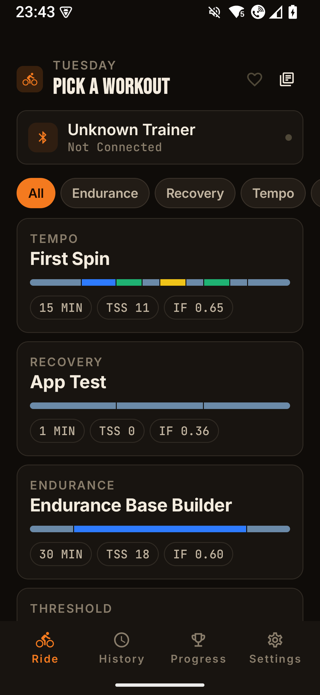
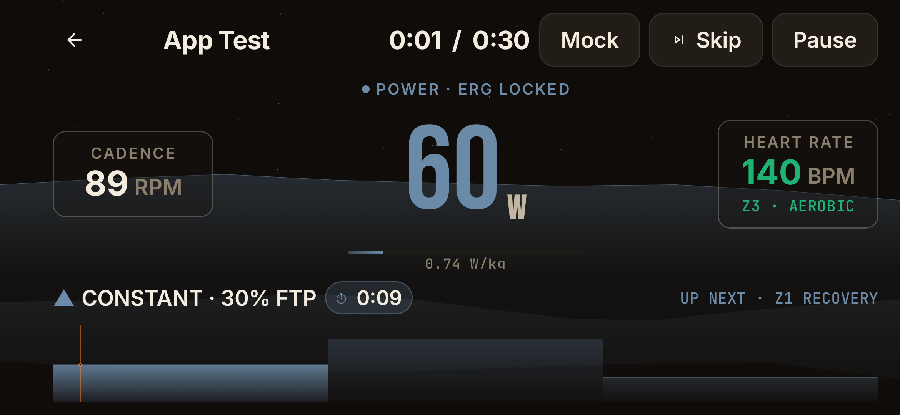
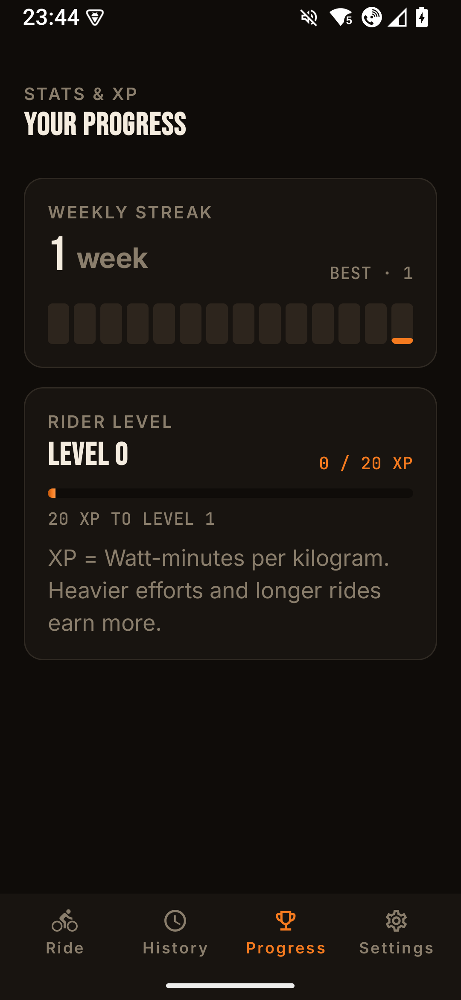

# Indoor Bike

A local-first, open-source indoor cycling app for Android. Connects to your smart trainer over standard BLE FTMS, runs structured power-zone workouts in ERG mode, and saves rides on your phone as files. No accounts, no subscriptions, no cloud required.

The companion website lives at [indoorbike.app](https://indoorbike.app), with an in-browser workout editor.

<p align="center">
  
  
  
</p>

## Features

- **BLE smart-trainer control** - Wahoo Kickr Core is the first-class target; any FTMS-compatible trainer should work. Optionally pair a Bluetooth heart-rate monitor and a Zwift Click v1 controller.
- **ERG mode** - the app drives the trainer to each interval's target wattage automatically. You hold cadence, it holds watts.
- **Just ride** - no workout, no plan. Starts at 40% of your FTP, counts up, and holds whatever power you dial in with the +/- buttons until you stop. Saved, exported and counted towards your progression like any other ride.
- **Simulation** - ride a real-world GPX route. The trainer is put into FTMS simulation mode instead of ERG, so what you feel is the road's own resistance rather than a target wattage, and your speed along the route comes from the watts you actually produce. Virtual gears shift without touching your bike, modelled on real chainrings and cassettes: pick a road double, a 1x gravel bike or a 1x mountain bike in Settings, along with your bike's weight. The HUD shows an OpenStreetMap map, the elevation profile and the live gradient; the post-ride summary and share image show the route you covered.
- **Plain-text JSON workouts** - readable, hand-editable, and shareable. Use the bundled library, drop in your own, fetch a community pack from a URL or QR code, or build them visually in the [browser editor](https://indoorbike.app/editor/).
- **Local progression** - streaks, rider levels, badges, week-grouped history, and time-in-zone - all computed on-device from saved rides.
- **FIT export and optional Intervals.icu sync** - strict opt-in. Manual upload from the post-ride screen or auto-upload after a ride; nothing leaves the device unless you configure credentials.
- **No Google, no tracking** - no Google Play Services, no analytics, no crash reporters, no proprietary blobs. It runs on a phone with no Google services on it at all: a de-Googled ROM, a Huawei handset, an emulator image without GApps. Auth0 / CleverCloud sync are entirely optional and lazily loaded.
- **Side-by-side debug + release installs** - different application IDs and a differently coloured launcher icon for debug, so you can ride against production while developing.

## Status

Pre-release. Currently in active development. iOS is on the roadmap but not started - the shared module is already KMM, so the lift should be reasonable.

## Install

The easiest way to install and stay updated is [ObtainX](https://github.com/bikram-agarwal/ObtainX), which pulls signed APKs straight from this repo's [releases](https://codefloe.com/SnappTechnology/IndoorCyclingApp/releases) - no store account, no Google services. Install ObtainX, choose **Add App**, and paste:

```
https://codefloe.com/SnappTechnology/IndoorCyclingApp
```

ObtainX then notifies you whenever a new release is published. You can also grab the APK directly from the [latest release](https://codefloe.com/SnappTechnology/IndoorCyclingApp/releases/latest).

## Building from source

Windows host with PowerShell:

```powershell
.\gradlew.bat :mobile_clients:android:installDebug
adb shell am start -n app.indoorbike.debug/app.indoorbike.MainActivity
```

macOS / Linux: substitute `./gradlew` for `.\gradlew.bat`.

See [CONTRIBUTING.md](CONTRIBUTING.md) for the full build / test / variant workflow, and [docs/ARCHITECTURE.md](docs/ARCHITECTURE.md) for how the modules fit together.

## Community workouts

The More Workouts screen lets riders import single workouts from a file, scan a QR from the [browser editor](https://indoorbike.app/editor/), paste an HTTPS URL, or browse community repositories. The community list comes from a registry at `BuildConfig.REGISTRY_URL` (default `https://indoorbike.app/registry.json`); when a rider opens a repo, the app fetches it on demand and they pick individual workouts to keep - each one becomes a static local copy. The registry is graceful about being unreachable: Browse just shows an empty state and the QR / paste-URL / file-import paths still work.

To self-host a registry or repository, override `REGISTRY_URL` at build time, or simply paste a manifest URL from inside the app. The on-disk schema is documented in [docs/ARCHITECTURE.md](docs/ARCHITECTURE.md#workout-library--sources-import-repositories).

## Editor URL API

Third-party tools can open the [browser editor](https://indoorbike.app/editor/) with a workout already loaded, using plain URL parameters - no backend, no account, no SDK. For example, [VertMatch](https://indoorbike.app/editor/?name=Threshold+3x8&ftp=250&s=10m@50,3x(8m@100;4m@55),5m@50) could turn training data into a workout and hand it off; the rider tweaks it and sends it to their phone via the usual QR / share flow.

- **Quick start (website):** [`indoorbike.app/api`](https://indoorbike.app/api/)
- **Full technical reference:** [docs/EDITOR_URL_API.md](docs/EDITOR_URL_API.md)
- **Machine-readable spec for LLMs / codegen:** [`indoorbike.app/editor/llms.txt`](https://indoorbike.app/editor/llms.txt)

Optional, free-to-use "Open in Indoor Bike" badges (SVG, with embed code) live at [`indoorbike.app/badges`](https://indoorbike.app/badges/) - handy if you'd like an on-brand button, but never required; a plain text link works just as well.

## Privacy

By default the app makes zero outbound network calls. Optional features that *do* talk to a server, all opt-in:

- **Community workout subscriptions** - only the URLs you've explicitly added.
- **Intervals.icu sync** - only when you've configured credentials and triggered an upload.
- **Auth0 / CleverCloud account sync** - only when you sign in.

Full privacy policy: [website/privacy.html](website/privacy.html).

## License

GNU General Public License v3.0 - see [LICENSE](LICENSE).

Third-party code and font attributions: [NOTICE.md](NOTICE.md).

## Repository

Home: [codefloe.com/SnappTechnology/IndoorCyclingApp](https://codefloe.com/SnappTechnology/IndoorCyclingApp). The Codeberg mirror is retired; 2.0.1 was the last release published there, and ObtainX sources still pointed at it should be repointed to the CodeFloe URL.
